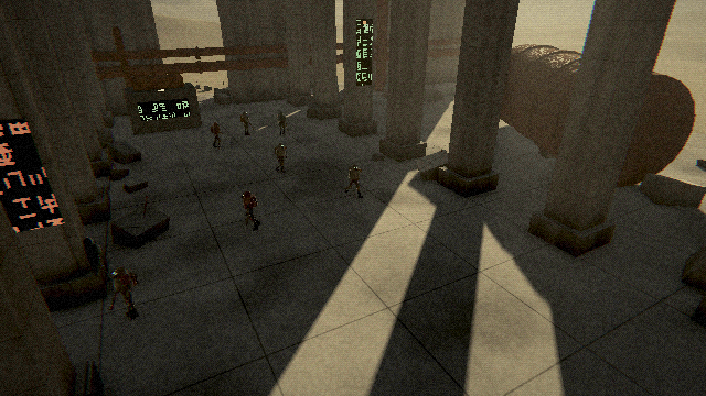
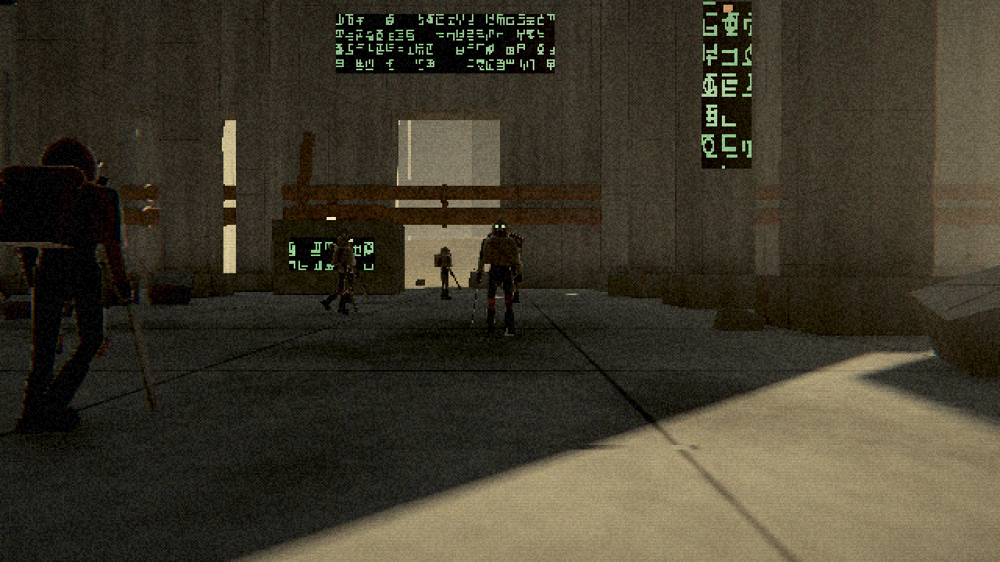
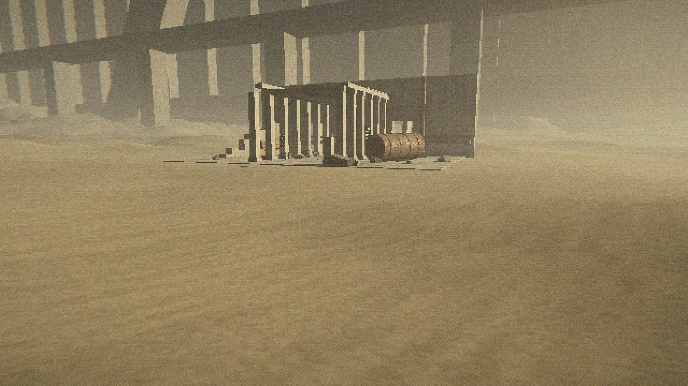

# Anathemyre

Открытый мир с живой симуляцией фракций. Чистый C11, без движка и сторонних библиотек в рантайме: окно, ввод, загрузка OpenGL, рендер и пост-обработка написаны с нуля. Правила проекта в [CLAUDE.md](CLAUDE.md).



## Сейчас: этап 0, тестовая комната

- Платформа Linux: X11 + GLX, контекст OpenGL 4.5 core, свой загрузчик функций GL (libGL подгружается через `dlopen`).
- Рендер в низком внутреннем разрешении (по умолчанию 640×360) с апскейлом без фильтрации.
- Тени от низкого солнца, высотный туман, объёмные лучи, затенение углов.
- Пост-обработка: грязный грейд, виньетка, плёночное зерно.
- Процедурная сцена: бетонный зал с колоннадой, руины, трубы, резервуар, знаки неизвестного языка, мегаструктуры у горизонта.
- Процедурные фигуры (~4 тыс. треугольников): капюшон, респиратор, снаряжение, скелет из 11 костей, GPU-скиннинг, процедурная ходьба.
- RTS-камера.

| | |
|---|---|
|  |  |

## Сборка и запуск

Нужны компилятор C, make и заголовки X11:

```sh
# Ubuntu / Debian
sudo apt install build-essential libx11-dev
# Fedora
sudo dnf install gcc make libX11-devel
# Arch
sudo pacman -S base-devel libx11
```

```sh
make            # релиз -> build/anathemyre
make run        # собрать и запустить
make debug      # отладка с ASan/UBSan -> build/anathemyre_debug
make run-debug
```

Быстрый цикл после правок: `./tools/run.sh` подтягивает свежий код текущей ветки, собирает и запускает игру. `./tools/run.sh имя-ветки` сначала переключается на ветку.

Windows пока через WSL2 (WSLg даёт X11 и OpenGL). `tools/run.sh` сам включает драйвер D3D12, чтобы рисовала видеокарта; при ручном запуске нужен `GALLIUM_DRIVER=d3d12`, иначе в строке `GL:` будет `llvmpipe` (программный рендер). Нативный порт Win32 + WGL будет отдельным этапом.

## Управление

| Клавиша | Действие |
|---|---|
| WASD, стрелки | сдвиг камеры (Shift — быстрее) |
| Q / E, правая кнопка мыши | поворот и наклон |
| Колесо | дистанция |
| F1 | стиль вкл/выкл |
| F2 | внутреннее разрешение: 270 / 360 / 540 / 720 |
| F3 | vsync вкл/выкл |
| F5 | перезагрузить шейдеры из `data/shaders` |
| Esc | выход |

## Параметры командной строки

```
--size W H                  размер окна
--res H                     высота внутреннего разрешения
--seed N                    зерно мира
--novsync                   без vsync (для замеров)
--cam X Z YAW PITCH DIST    положение камеры
--shot file.ppm [--frames N] снять кадр и выйти
```

## Замер производительности

Каждые 2 секунды в консоль пишется строка `КАДР:` с временем кадра и разбивкой: CPU (логика, отправка команд, ожидание swap) и GPU по проходам (тени, сцена, атмосфера, стиль, апскейл), по меткам времени `GL_TIMESTAMP`. Если сумма GPU сильно меньше времени кадра, узкое место не в рендере, а в CPU, драйвере или выводе окна.

## Структура

```
src/core/      арены, RNG, время, лог, математика
src/platform/  окно, ввод, GL-контекст (platform_linux.c)
src/render/    загрузчик GL, геометрия, рендерер
src/game/      тестовая комната, персонаж
data/shaders/  GLSL: сцена, атмосфера, стилизация
tools/         скрипт запуска, подавления LSan для драйвера
```
